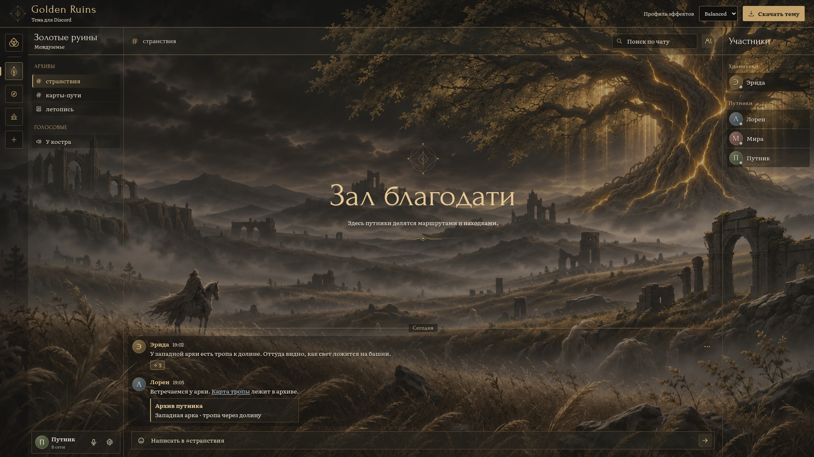

# EldenRing theme

**Golden Ruins** — фанатская тема для Discord с полупрозрачными панелями, акцентами старого золота и приложенной иллюстрацией «Золотые руины под древним древом». Обои видны в чате и на странице «Друзья». В CSS встроены Forum для заголовков, Literata для интерфейса и сообщений, орнаменты и знак из колец для кнопки «Главная».

[Скачать GoldenRuins.theme.css](dist/GoldenRuins.theme.css) · [Открыть предпросмотр](docs/preview.html) · [English](#english)

[Страница «Друзья»](docs/preview-friends.jpg) · [Голосовой канал](docs/preview-call.jpg) · [Меню профиля](docs/preview-account.jpg)

## Установка

1. Сохраните `dist/GoldenRuins.theme.css`.
2. В **BetterDiscord** откройте **Настройки пользователя → BetterDiscord → Themes → Open Themes Folder**. Скопируйте файл в папку и включите тему.
3. В **Vencord** откройте **Настройки пользователя → Vencord → Themes → Local Themes → Open Themes Folder**. Скопируйте файл и включите тему в списке.

Для **Online Themes** в Vencord нужна прямая HTTPS-ссылка на CSS, доступная клиенту. Для локальной установки достаточно одного файла `.theme.css`.

## Настройки

Вставляйте свои переменные в **Custom CSS** в BetterDiscord или **QuickCSS** в Vencord, чтобы сохранить настройки при обновлении темы. **Balanced** применяется по умолчанию. Готовые блоки Full, Balanced и Lite и список параметров находятся в руководстве. [Настройка Golden Ruins](docs/customization.md)

## Сборка и проверка

Сборка работает на Node.js 18+ без зависимостей. Флаг `--check` сверяет артефакт с исходниками.

~~~sh
node scripts/build.mjs
node scripts/build.mjs --check
~~~

Откройте `docs/preview.html` для локального предпросмотра. При необходимости запустите `python -m http.server 4173` из папки репозитория и откройте `http://localhost:4173/docs/preview.html`.

Статический срез CSS Discord и предпросмотр проверены в Chromium. Приёмка в настольных BetterDiscord и Vencord и сравнение производительности с обычным Discord остаются открытыми. [Матрица проверок](docs/test-matrix.md)

[Референсы](docs/references.md) · [Селекторы Discord](docs/selectors.md) · [История изменений](docs/changelog.md) · [Авторы и права](CREDITS.md)

## English

**Golden Ruins** is a fan-made Discord theme with wallpaper behind the chat and Friends list, weathered gold accents and translucent panels. The single CSS release embeds the wallpaper losslessly, contains Forum headings and Literata interface and message text, and adds an interlocking ring emblem to the Home button.

Put the CSS file in **BetterDiscord → Themes → Open Themes Folder** or **Vencord → Themes → Local Themes → Open Themes Folder**, then enable it. Vencord's Online Themes accepts a directly accessible HTTPS URL to the CSS. [GoldenRuins.theme.css](dist/GoldenRuins.theme.css)

Set `--gr-*` in **Custom CSS** or **QuickCSS**. Balanced is the default preset. Run `node scripts/build.mjs` to build and add `--check` to verify the bundled file. [Full, Balanced and Lite presets](docs/customization.md)

The preview was tested in Chromium. [Live-client and performance test matrix](docs/test-matrix.md)
